# Architecture

RoadSafe UK separates annual batch computation from read-only application
serving.

## Implemented pilot

Python batch commands validate and match DfT inputs, write Parquet/GeoJSON and
JSON provenance reports, and run statistical benchmarks separately. FastAPI
reads collision Parquet (or CSV fixtures), network GeoJSON and optional
retrospective Empirical Bayes Parquet. React/MapLibre loads these read-only
endpoints over an OpenStreetMap raster basemap and exports selected-link evidence
as JSON. Source artifacts are cached by the API until restart.

Both bundle and individual-path configurations load a validated startup snapshot.
Hashes are computed from the same bytes that are parsed, so later disk changes
cannot pair cached observations with fingerprints of replacement files. Bundle
snapshots additionally match the declared artifact hashes. Validation checks
collision values, network fields/geometry and retrospective record semantics,
not just counts and checksums. Observed networks cannot carry model fields.
The retrospective endpoint projects only its validated EB fields; matching a
forecast artifact's year and segment keys is not sufficient for acceptance.
These checks reject incompatible inputs, not independently authenticate a model's
scientific provenance or the source dataset.

Forecasting predictions are not served. DuckDB snapshots, PMTiles, national
vector serving, persisted investigations and model-comparison endpoints are
not implemented in this pilot.

## Road-focused investigation

Selecting a stable road key adds a distinct outline and dims other road links
without changing their analytical values. Matched collision points retain their
reported coordinates and severity; they are not snapped to a line or assigned
by browser proximity. Clearing the road restores network context.

`GET /api/v1/segments/{segment_key}/collisions` derives accepted, unambiguous
assignments from the frozen collision data and canonical road geometry using
the existing British National Grid distance/ambiguity rules. Its snapshot-local
cache is accepted only when every road's reconstructed collision and KSI counts
agree with the served network. A mismatch returns unavailable evidence with no
points, not a guessed association. The response includes its road key, year,
artifact fingerprints and matching parameters. An available empty list means a
verified zero-count selection; unavailable evidence does not establish absence.

Successful versioned data responses carry a browser-readable
`X-RoadSafe-Snapshot` token derived from the application version and frozen
collision/network/retrospective fingerprints. The browser binds its initial
data and optional metadata/model responses to this identity before combining
them. Matched-point requests also check road key, year and artifact fingerprints;
superseded requests cannot replace a newer road selection. The token establishes
data-version coherence, not authentication or scientific source validity.

The normal pilot has 330 accepted assignments and 76 KSI collisions across 256
links. Local verification compared their exact identities with both the saved
assignment artifact and original shapefile matching. Other collisions remain
ambiguous or outside the major-road matching scope. Generalised geometry and a
distance-based rule do not establish lane-level location or causal responsibility.

## Target architecture

The diagram below is the intended evolution, not a description of current
deployment. OS Open Roads is also a planned source rather than the current
DfT Major Roads Database geometry.

```mermaid
flowchart LR
    DFT[DfT STATS19] --> ACQUIRE[Atomic acquisition and validation]
    TRAFFIC[DfT traffic counts] --> ACQUIRE
    ACQUIRE --> MANIFEST[Checksums and provenance manifests]
    MANIFEST --> RAW[Versioned raw assets]
    OS[OS Open Roads] --> RAW
    RAW --> VALIDATE[Validation and decoding]
    VALIDATE --> MATCH[Road and exposure matching]
    MATCH --> FEATURES[Annual segment evidence]
    FEATURES --> PANEL[Validated segment-year panel]
    PANEL --> GATE[Contract readiness gate]
    GATE --> MODELS[Statistical and ML evaluation]
    MODELS --> PUBLISH[DuckDB snapshot and PMTiles]
    PUBLISH --> API[FastAPI evidence API]
    PUBLISH --> WEB[React and MapLibre]
```

In the target architecture, the browser would receive national vector geometry
from static PMTiles. Expanded API endpoints would serve comparisons and saved
investigations. Models remain batch-scored; current map interaction does not
invoke training or online inference.

The exposure pipeline uses British National Grid (`EPSG:27700`) for metric
matching and WGS84 (`EPSG:4326`) for API geometry. Collision-to-link matches,
segment evidence, GeoJSON serving artifacts, and a network quality report are
written separately so rejected matches remain auditable.

Annual serving identifiers retain the source year and geometry version. The
panel additionally uses `dft-count-point-{id}` as a stable analytical key,
because DfT defines the count point as the road-link reference shared by AADF
and the Major Roads Database. The panel never assumes geometry is unchanged:
the annual `segment_id` and `source_year` remain alongside the stable key.

Panel construction is separate from model fitting. It validates annual schema,
year consistency, segment-year uniqueness, checksums, exposure, targets, and
the subgroup fields declared in the evaluation contract. A blocked report is
a valid artifact; no model output is promoted while blockers remain.
