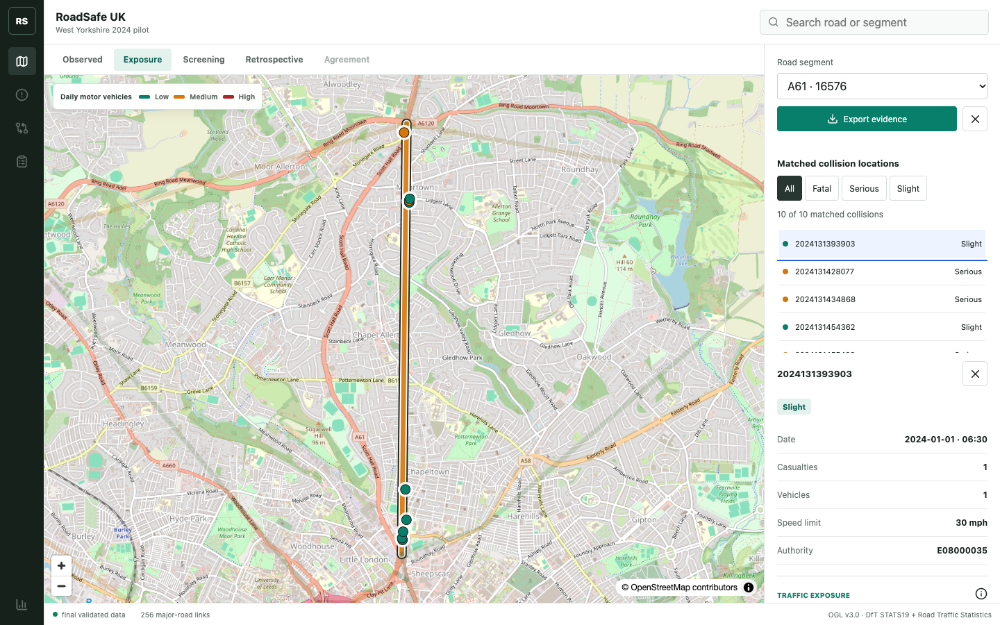
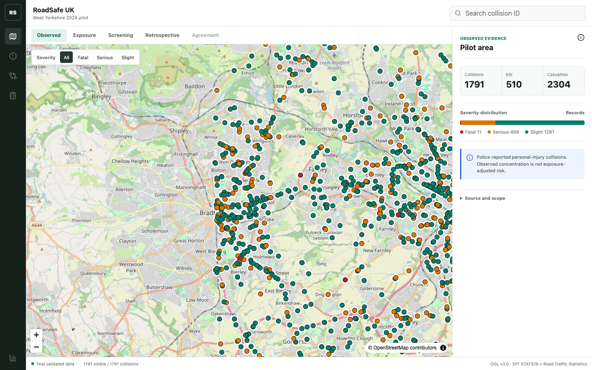
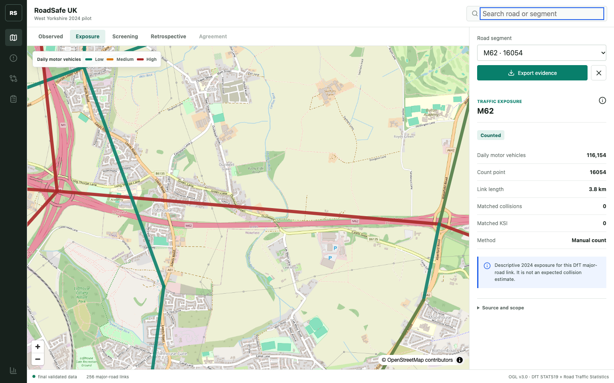
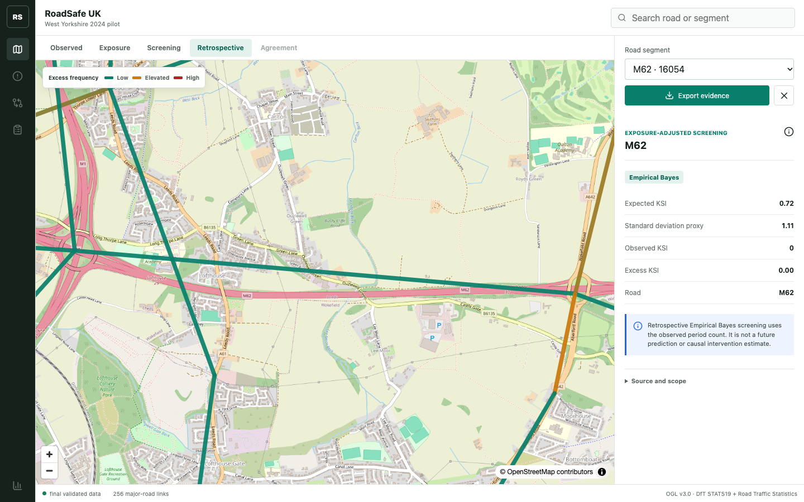

# Investigation demo

## Presentation goal

Demonstrate one complete analyst task: inspect a major-road link, compare its
observations with exposure and retrospective screening, then export the evidence
and limitations. Present the forecasting experiment separately as a benchmark,
not as the model driving the map.

Current status: local production-build verification against the full pilot,
including desktop/mobile screenshots, keyboard-only investigation and real
evidence downloads. Public deployment, publication of the recording, a complete
accessibility audit and other browser engines remain pending. Screenshots below
are working screens, not mockups.

## Run the application

Follow the [README setup](../README.md#quick-start). The default configuration
uses the small traceable fixture; it must not be recorded as the full pilot.
For the full pilot, build the 2024 collision artifact and the contract-v1 annual
network/panel artifacts (use `--output data/processed/contract-v1` with the
README's `build-contract` command), then generate retrospective evidence:

```bash
roadsafe build-empirical-bayes \
  --panel data/processed/contract-v1/segment-year-panel.parquet \
  --contract configs/evaluation-v1.json \
  --output data/processed/contract-v1/empirical-bayes

roadsafe build-demo-bundle \
  --collisions data/processed/pilot-collisions-2024.parquet \
  --network data/processed/contract-v1/segment-evidence-2024.geojson \
  --empirical-bayes data/processed/contract-v1/empirical-bayes/empirical-bayes-screening.parquet \
  --profile pilot --output data/processed/demo-bundle-2026-10-13

roadsafe verify-demo-bundle --bundle data/processed/demo-bundle-2026-10-13

ROADSAFE_BUNDLE_PATH=data/processed/demo-bundle-2026-10-13 \
  uvicorn roadsafe.api.app:app --host 127.0.0.1 --port 8000
```

In a second terminal, run `npm run dev` from `apps/web` and open the URL it
prints. The usual URL is `http://localhost:5173`. Restart the API after replacing
artifacts because data and metadata are cached. If using another frontend port,
update the API CORS allowlist; the current allowlist covers port 5173 only.
Never combine a legacy network artifact without stable keys with current EB data.

### Verified serving bundle

The bundle copies collision, network and optional retrospective artifacts into
one portable directory. `bundle.json` records their SHA-256 hashes, 2024 scope,
counts, attribution and explicit non-promotion status. Building rejects existing
output directories; incomplete builds have no completion manifest. Verification
checks file containment, hashes, reporting year, unique identities, declared
counts, aggregate collision/KSI/non-KSI bounds, positive finite exposure,
count/rate consistency and retrospective key/count alignment. Rounded fixture
rates remain supported. These checks do not require every source collision to
match a major-road link. The current bounded profiles are
the 12-record/6-link fixture and the 1,791-record/256-link pilot, not arbitrary
national releases.

Do not combine `ROADSAFE_BUNDLE_PATH` with individual artifact environment
variables. Startup verifies the bundle and freezes the loaded data and metadata
together. `GET /api/v1/release` identifies the verified manifest and application
version. Replacing files does not update a running server: verify and restart.
Legacy individual-path configurations remain supported but are not reported as
verified bundles. Keep these generated artifacts out of Git.

Hash and alignment checks establish integrity, not independent source
authenticity, historical feature availability or forecasting validity. Public
hosting, release-commit CI and deployment smoke checks remain separate gates.

## Recording storyboard: approximately two minutes

| Time | Show | Explain |
| --- | --- | --- |
| 0:00-0:20 | Observed view, source/scope and severity filter | Police-reported collisions; the map is not a causal risk estimate |
| 0:20-0:45 | Exposure view; search a road and select a count point | Counts need traffic context; distinguish counted from estimated AADF |
| 0:45-1:05 | Screening view and the same count point, reselected if necessary | Observed exposure-normalised rate and matching scope |
| 1:05-1:25 | Retrospective view and the same count point | Shrinkage, observed versus expected KSI and standard-deviation proxy; not a future forecast |
| 1:25-1:45 | Export evidence; open the downloaded JSON | Canonical road geometry, source fingerprints and limitations |
| 1:45-2:00 | Model card results and remaining gates | Ridge improves errors, but calibration and feature availability still block promotion |

Choose a segment after inspecting actual evidence, not because it implies a
dramatic outcome. Keep its count-point ID consistent across modes. Do not hide
missing evidence or narrate a model ranking that the interface does not provide.

## Visual acceptance before recording

- Check desktop (1440 x 900) and mobile (390 x 844 and 320-pixel width).
- Verify base tiles and evidence geometry render, and mode switching changes
  the visible layer even during initial map loading.
- Check keyboard focus, road selection, search, empty results, clear selection
  and unavailable-model states; labels must fit without overlap.
- Confirm the full pilot shows 1,791 collisions and 256 road links; verify source
  metadata identifies the pilot rather than the fixture.
- Download a real JSON file and compare its selected ID, counts, geometry and
  fingerprints with the API. Inspect the browser console for errors.
- Preserve DfT and OpenStreetMap attribution in screenshots and the recording.

## Repository presentation

Real screenshots are included below and linked near the README introduction.

Attach a short MP4 to a GitHub release or other public video host, then link the
recording from the README. Keep large videos and raw datasets out of Git. A public
interactive deployment is a separate milestone: it needs a reproducible serving
bundle, read-only API hosting, CORS configuration and a deployment smoke test.

For each published demo, record the commit, artifact fingerprints, fixture/pilot
scope, validation date and known limitations. Claim local checks only until the
published commit's CI has actually run. The model card and benchmark should sit
beside the visual demo so viewers can inspect both engineering and analytical work.

## Verified local screenshots

### Selected-road focus, 28 October 2026

The current production build highlights the selected road and dims other links.
It shows count-verified spatially matched collisions by severity, preserves road
focus across modes and supports point selection from either the map or keyboard
list. Initial evidence responses are bound to one frozen snapshot identity.



[390-pixel mobile view](media/focused-road-mobile-390.png) /
[320-pixel mobile view](media/focused-road-mobile-320.png).

The illustrated A61 count point 16576 is the first stable-key-sorted road with
nonzero matched collisions: 10 collisions, including 3 KSI collisions. It is not
selected for a model score or claimed intervention benefit. Point coordinates
are the original reported locations, not snapped to the drawn line. Existing
generalisation and uncertainty limitations still apply.

The current local acceptance run has 15 Chrome tests: 11 real-pilot workflows and
four explicitly synthetic API-fixture tests. The latter exercise renderer clicks,
unavailable evidence and retry behaviour; they are not real-data matching proof.
The three new pilot workflows verify the nonzero road and a zero-count road at
1440, 390 and 320 pixels, checking actual endpoint provenance, collision counts,
keyboard selection, mode persistence, tiles and page overflow. Screenshots were
visually inspected. Retrospective fixtures include actual expected-value display
assertions rather than treating an available tab as proof of merged data.

### Earlier pilot capture, 23 October 2026

Refreshed on 23 October 2026 from the uncommitted local production build using
Chrome 155 at 1440 x 900 and mobile widths 390 and 320 (height 844). The pilot
contains 1,791 collision records and 256 major-road links. The desktop selection
is the first stable segment key, M62 count point 16054, not a selected high-risk
example. DfT link geometry is generalized and can diverge from the basemap road;
neither the visual lines nor matching results establish lane-level accuracy.







[Narrow-mobile retrospective view](media/retrospective-mobile-320.png).
The mode toolbar scrolls horizontally on narrow screens; the page itself does not.

### Repeat the browser checks

Start the full-pilot API and frontend as above, then from `apps/web`:

```bash
npm ci
npx playwright install chromium
npm run check
npm test -- --run
npm run test:e2e
```

Repeat against the production build, not only the development server: stop the
frontend development server, run `npm run build`, then
`npm run preview -- --host 127.0.0.1 --port 5173 --strictPort` and rerun
`npm run test:e2e`. Keep the verified-bundle API running. Preview is a local QA
server, not a production hosting recommendation.

The original eight tests use real API data and browser downloads. Three added
pilot tests cover focused-road collision evidence, while four separately labelled
fixture tests deliberately mock API data for renderer/error-state coverage.
The suite checks counts, mode selection, empty search, clear selection, export
geometry, observed counts and source fingerprints, with desktop page-error checks
and mobile overflow checks. Screenshots wait for the map's idle state. Successful
OSM tile responses are required; network access and the complete pilot artifacts
are prerequisites. These are opt-in local acceptance tests, not fixture-only CI.
Outputs are in ignored `apps/web/test-results/`. `ROADSAFE_WEB_URL` and
`ROADSAFE_API_URL` override the default local test endpoints.

Source fingerprints for this capture:

Verified bundle manifest SHA-256:
`546e501187a67b9caa5788c23a0d41d50faa7c5efc59506b28c61e437a082a2e`.

| Artifact | SHA-256 |
| --- | --- |
| Collisions | `16c6583169c84270b54db8ccf91b36a6a019602369829c2b05831531c2050dea` |
| Network | `b23ecdcd7ff3b661c2e4e23cd437a3f7d19c88f585b2650765d45dabfa060a82` |
| Retrospective | `6d163cc35e4c43c89a0c49da0fbc590b455d02f905c04aa57f09a0e63b53f6b5` |

Contains DfT information under OGL v3.0; basemap copyright OpenStreetMap
contributors. Attribution remains visible in the images. This is local evidence,
not a release-commit or remote-CI certification.

## Targeted keyboard review, 23 October 2026

Evidence modes and severity filters expose their selected state through
`aria-pressed`. The search input retains a visible focus outline. The tested
keyboard workflow covers mode switching, empty search and recovery, native
road-selection type-ahead, retrospective evidence, JSON download, clear selection
and source-details expansion at 1440- and 320-pixel widths. Search focus is also
checked at 390 pixels. Production screenshots were visually inspected for
readable controls, unclipped focus at desktop width, evidence geometry and
attribution. These checks are not a WCAG conformance claim or a screen-reader
certification. Individual collision-point selection still relies on map clicks.

At that 23 October milestone, the local suite had eight real-pilot browser tests,
15 frontend unit tests and 162 Python tests. Ruff, strict mypy, frontend/E2E TypeScript,
production build and whitespace checks passed. Local browser verification used
Chrome 155 with Node 24 through a local-only runner configuration; results from
the uncommitted tree are not remote CI for the published repository.

## Reproduce the local recording

Keep the verified-bundle API and production preview running, then from `apps/web`:

```bash
node scripts/record-demo.mjs --output ../../output/playwright/production-demo
```

The default uses Playwright's matching Chromium. `--channel chrome` selects an
installed Chrome instead. Node 24 and Chrome 155 were used locally. On macOS,
that channel's backing window is enlarged without changing the 1440 x 900
application viewport, so the video includes the footer. Always inspect encoded
frames; correct screenshot dimensions alone do not establish recording quality.

The command requires a fresh output directory, production `/assets/` entry
files and the verified 2024 pilot bundle. It checks successful basemap tile
responses and map idle, records the first stable segment-key road (M62 count
point 16054 in this pilot), and validates the real download against canonical
geometry and source metadata. It refuses output reuse. Failure can leave a
partial directory but cannot publish a completion manifest.

Outputs include WebM, screenshots, the selected evidence JSON, and `capture.json`
with media hashes, production entry-asset hashes, browser identity, pacing and
verified-bundle metadata. Lazy-loaded asset coverage is not claimed. The manifest
records capture completion **pending visual review**, never automatic video
acceptance. `--hold-ms 0` is an explicitly labelled smoke capture, not a paced
presentation. The default pauses allow reading each state; they do not replace
application-readiness checks. No narration or public upload is generated.

After checking actual video frames for evidence layers, source/OSM attribution,
footer and readable panels, an optional MP4 conversion is:

```bash
ffmpeg -i ../../output/playwright/production-demo/roadsafe-pilot.webm \
  -c:v libx264 -preset veryfast -crf 23 -pix_fmt yuv420p -movflags +faststart \
  ../../output/playwright/production-demo/roadsafe-pilot.mp4
```

Keep capture outputs out of Git; publish an accepted recording as a release
attachment or public video link only after reviewing the release revision.
